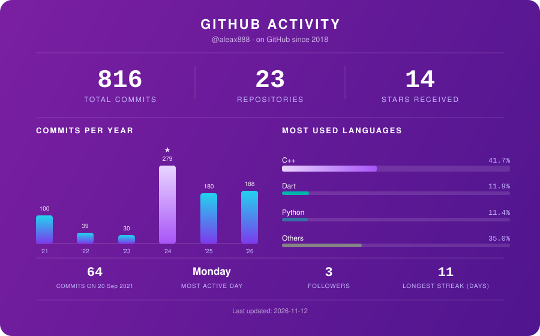
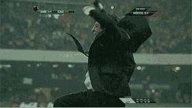

<!-- Banner -->

  

<!-- Name -->

  

<h1 align="center">Hi, I am Alex 👋</h1>

<!-- Some info -->
<h5 align="center">BACKEND & MOBILE · PERÚ (UTC-5)</h5>

I build mobile apps and backends, follow interesting ideas, and learn whatever the next challenge needs.

I like exploring what I can create with AI, too. 

---

<!-- tech stack -->
<h3 align="center">Tech I use</h3>

  

---

<!-- contact -->
<h3 align="center">Find me around the internet</h3>
<table align="center" style="border: 0;">
  <tr>
    <td align="center">
      
       
      Website
    </td>
    <td align="center">
      
       
      Itch.io
    </td>
    <td align="center">
      
       
      Email
    </td>
    <td align="center">
      
       
      LinkedIn
    </td>
    <td align="center">
      
       
      Medium
    </td>
    <td align="center">
      
       
      DEV.to
    </td>
  </tr>
</table>

---

  

---

<!-- github stats -->

  

---

<!-- a little personality -->

  

  <i>Me when the project finally works after “one small change”.</i>

---

<!-- close image -->

  

 <i>Built from Arequipa, shipped to the world 🌎</i> 

